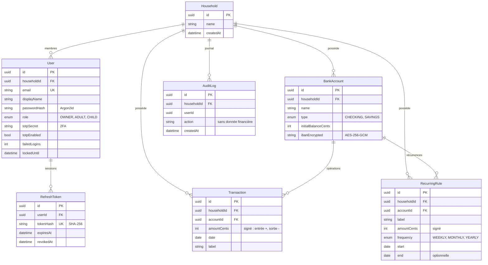

# Gest-finance

PWA de gestion des finances du foyer : comptes bancaires, entrées et sorties (ponctuelles ou récurrentes), **reste à vivre** recalculé à chaque modification. Données sensibles : isolation par foyer, IBAN chiffré, 2FA.

> Ce README est mis à jour à chaque itération (schéma de base, fonctionnalités, démarrage). Le suivi détaillé est dans [`TODO.md`](TODO.md) (reste à faire) et [`DONE.md`](DONE.md) (réalisé, par fonction).

## Architecture
Monorepo pnpm, TypeScript partout.

| Dossier | Rôle |
|---|---|
| `apps/api` | API NestJS + Fastify, Prisma, PostgreSQL |
| `apps/web` | Front React + Vite + TanStack Query + Tailwind, PWA installable |
| `packages/finance-core` | Domaine pur, sans E/S : `occurrences()` (récurrences) et `resteAVivre()` |
| `packages/shared` | Schémas Zod partagés entre l'API et le front |
| `infra/docker` | PostgreSQL et Redis de développement |

## Base de données



**Lecture du schéma.**
- Un **foyer** (`Household`) regroupe des **utilisateurs** (`User`, rôles `OWNER`, `ADULT`, `CHILD`) et toutes les données financières. Chaque table de données porte un `householdId` : toutes les requêtes de l'API sont filtrées par le foyer du jeton, jamais par un paramètre envoyé par le client.
- Un **compte bancaire** (`BankAccount`) porte un solde initial et un IBAN chiffré. Son **solde courant** n'est pas stocké : il est calculé = solde initial + opérations + occurrences de règles récurrentes déjà échues.
- Une **opération** (`Transaction`) est ponctuelle, en centimes signés (entrée positive, sortie négative).
- Une **règle récurrente** (`RecurringRule`) décrit un salaire, un loyer, un abonnement… (hebdomadaire, mensuel, annuel, avec fin optionnelle). Les occurrences ne sont pas stockées : `finance-core` les génère à la demande.
- `RefreshToken` stocke uniquement l'empreinte SHA-256 du jeton de session, avec rotation et révocation. `AuditLog` garde les actions (connexion, ajout…), sans montants ni secrets.

**Reste à vivre** = revenus (récurrents + ponctuels) − charges fixes récurrentes − dépenses ponctuelles, sur la période demandée (`GET /summary?from&to`), recalculé à chaque lecture donc après chaque ajout, modification ou suppression.

## Fonctionnalités en place

| Domaine | Fonctionnalité |
|---|---|
| Authentification | Inscription d'un foyer, connexion, déconnexion ; mot de passe Argon2id ; cookies HttpOnly + SameSite=Strict ; refresh token à rotation (réutilisation détectée = sessions révoquées) ; verrouillage 15 min après 5 échecs ; réponses identiques pour compte inconnu ou mauvais mot de passe |
| 2FA | Activation TOTP depuis le tableau de bord ; code exigé à la connexion ensuite |
| Foyer et rôles | Ajout de membres par le propriétaire ; `OWNER`/`ADULT` écrivent, `CHILD` en lecture seule ; journal d'audit (API, propriétaire) |
| Comptes | Création, liste (solde courant, IBAN masqué), modification, suppression ; IBAN chiffré AES-256-GCM |
| Opérations | Création, liste, modification, suppression ; le compte doit appartenir au foyer |
| Récurrences | Création, liste, modification (dont fin), suppression ; hebdo, mensuel, annuel |
| Reste à vivre | Calcul du mois en cours, recalculé après chaque changement |
| Confidentialité | Bouton « Masquer les montants » (mémorisé sur l'appareil) |
| Sécurité HTTP | Helmet (CSP stricte), limitation de débit (429), validation Zod de toutes les entrées, PWA sans cache des appels API |
| Tests | `finance-core` (100 %), API sur PostgreSQL réel (28 tests), front (19 tests) |

À venir (voir `TODO.md`) : rappel hebdomadaire, import de relevés et catégorisation, lecture des fiches de paie, actualités financières, prévisionnel à 30/60/90 jours, passkeys, RLS PostgreSQL.

## Démarrage (développement)
Prérequis : Node 22+, pnpm 10, Docker.
```
pnpm install
docker compose -f infra/docker/compose.dev.yml up -d     # PostgreSQL + Redis
copy apps\api\.env.example apps\api\.env                  # (cp sous Linux/macOS)
cd apps/api && pnpm exec prisma migrate deploy && cd ../..
pnpm dev                                                  # API :3000 + front http://localhost:5173
pnpm test
```
