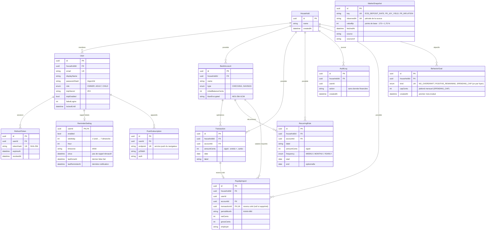

# Gest-finance

PWA de gestion des finances du foyer : comptes bancaires, entrées et sorties (ponctuelles ou récurrentes), **reste à vivre** recalculé à chaque modification. Données sensibles : isolation par foyer, IBAN chiffré, 2FA.

> Ce README est mis à jour à chaque itération (schéma de base, fonctionnalités, démarrage). Le suivi détaillé est dans [`TODO.md`](TODO.md) (reste à faire) et [`DONE.md`](DONE.md) (réalisé, par fonction).

## Architecture
Monorepo pnpm, TypeScript partout.

| Dossier | Rôle |
|---|---|
| `apps/api` | API NestJS + Fastify, Prisma, PostgreSQL |
| `apps/web` | Front React + Vite + TanStack Query + Tailwind, PWA installable |
| `packages/finance-core` | Domaine pur, sans E/S : `occurrences()` (récurrences) et `resteAVivre()` |
| `packages/shared` | Schémas Zod partagés entre l'API et le front |
| `infra/docker` | PostgreSQL et Redis de développement |

## Base de données



**Lecture du schéma.**
- Un **foyer** (`Household`) regroupe des **utilisateurs** (`User`, rôles `OWNER`, `ADULT`, `CHILD`) et toutes les données financières. Chaque table de données porte un `householdId` : toutes les requêtes de l'API sont filtrées par le foyer du jeton, jamais par un paramètre envoyé par le client.
- Un **compte bancaire** (`BankAccount`) porte un solde initial et un IBAN chiffré. Son **solde courant** n'est pas stocké : il est calculé = solde initial + opérations + occurrences de règles récurrentes déjà échues.
- Une **opération** (`Transaction`) est ponctuelle, en centimes signés (entrée positive, sortie négative).
- Une **règle récurrente** (`RecurringRule`) décrit un salaire, un loyer, un abonnement… (hebdomadaire, mensuel, annuel, avec fin optionnelle). Les occurrences ne sont pas stockées : `finance-core` les génère à la demande.
- `ReminderSetting` (une ligne par utilisateur) décrit son rappel hebdomadaire : jour, heure, fuseau. Le **créneau** du rappel est le dernier instant où tombent ce jour et cette heure ; le bilan est « dû » si ce créneau est postérieur à l'activation (`since`) et au dernier bilan fait (`lastDoneAt`). `lastReminderAt` garantit une seule notification par créneau.
- `PushSubscription` : un appareil abonné aux notifications. L'API n'envoie qu'aux services push connus des navigateurs (liste blanche anti-SSRF) ; la notification ne contient aucune donnée financière.
- `PayslipImport` garde uniquement les **métadonnées** d'une fiche de paie validée (période, net, brut, employeur, lien vers l'opération créée), jamais le PDF : le fichier est lu en mémoire par le serveur puis jeté. Il sert à détecter les doublons (même compte, période et net, tant que l'opération existe).
- `BehaviorGoal` : un **objectif de comportement mensuel** du foyer, au plus un par type : « pas de découvert » (aucun compte courant sous zéro, jour après jour), « reste à vivre positif », « dépenses sous un plafond » (`capCents`). L'évaluation n'est jamais stockée : `finance-core` la recalcule à chaque lecture à partir des comptes, règles et opérations (statut du mois en cours *en bonne voie / à surveiller / raté*, mois terminés *réussi / raté* depuis la création, 12 mois maximum, série de mois réussis d'affilée). Seuils : alerte à 80 % du plafond de dépenses, à moins de 10 % des revenus pour le reste à vivre.
- `MarketSnapshot` (indépendante des foyers, **aucune donnée personnelle**) mémorise les indicateurs publics récupérés chaque jour (taux de dépôt de la BCE, OAT 10 ans France, inflation IPCH France) : une ligne par indicateur et par période observée. Les taux réglementés (Livret A, LDDS, LEP, PEL) ne sont pas en base : ils sont dans une configuration versionnée avec source et période de validité (`apps/api/src/market/regulated-rates.ts`), car ils ne changent que les 1er février et 1er août.
- `RefreshToken` stocke uniquement l'empreinte SHA-256 du jeton de session, avec rotation et révocation. `AuditLog` garde les actions (connexion, ajout…), sans montants ni secrets.

### Isolation par ligne (RLS PostgreSQL, jalon 8b)
Le filtre `householdId` des requêtes est doublé par PostgreSQL lui-même : même si une requête oubliait son filtre, la base ne renverrait que les lignes du foyer connecté.
- **Trois rôles SQL** : `gest` (propriétaire des tables, utilisé **seulement** par les migrations et les tests, jamais par l'API), `gest_app` (requêtes des utilisateurs connectés, **soumis à la RLS**) et `gest_system` (inscription, connexion, journal d'audit, rappels, indicateurs : droits limités aux tables nécessaires, aucun accès aux comptes, opérations, règles ni fiches de paie). Les rôles sont créés par la migration `rls_foyer` ; leurs mots de passe viennent des URL de connexion (`pnpm db:roles`).
- **Foyer courant** : un hook Fastify lit le foyer dans le jeton vérifié et le garde pour toute la requête ; chaque requête SQL s'exécute dans une transaction qui fixe `app.household_id` (`set_config(..., true)`, local à la transaction). Les politiques `foyer` de chaque table comparent `householdId` à ce réglage. **Sans foyer, l'accès est refusé** (erreur) plutôt que silencieusement vide.
- **Tables** : `Household`, `User`, `AuditLog`, `BankAccount`, `Transaction`, `RecurringRule`, `PayslipImport` (par `householdId`) ; `RefreshToken`, `ReminderSetting`, `PushSubscription` (via l'utilisateur). `MarketSnapshot` (public) n'a pas de RLS. Le journal d'audit est en écriture seule pour l'application.
- **Garde-fous** : l'API refuse de démarrer si `DATABASE_URL` n'est pas le rôle `gest_app` (ou si ce rôle contourne la RLS) ; en production, `DATABASE_OWNER_URL` ne doit pas exister dans l'API ; un test échoue si une table est ajoutée sans RLS.
- **Nouvelle table du foyer** : dans sa migration, `ENABLE ROW LEVEL SECURITY`, une politique `foyer`, et les `GRANT` strictement nécessaires aux deux rôles.

**Reste à vivre** = revenus (récurrents + ponctuels) − charges fixes récurrentes − dépenses ponctuelles, sur la période demandée (`GET /summary?from&to`), recalculé à chaque lecture donc après chaque ajout, modification ou suppression.

## Fonctionnalités en place

| Domaine | Fonctionnalité |
|---|---|
| Authentification | Inscription d'un foyer, connexion, déconnexion ; mot de passe Argon2id ; cookies HttpOnly + SameSite=Strict ; refresh token à rotation (réutilisation détectée = sessions révoquées) ; verrouillage 15 min après 5 échecs ; réponses identiques pour compte inconnu ou mauvais mot de passe |
| 2FA | Activation TOTP depuis le tableau de bord ; code exigé à la connexion ensuite |
| Foyer et rôles | Ajout de membres par le propriétaire ; `OWNER`/`ADULT` écrivent, `CHILD` en lecture seule ; journal d'audit (API, propriétaire) |
| Comptes | Création, liste (solde courant, IBAN masqué), modification, suppression ; IBAN chiffré AES-256-GCM |
| Opérations | Création, liste, modification, suppression ; le compte doit appartenir au foyer |
| Récurrences | Création, liste, modification (dont fin), suppression ; hebdo, mensuel, annuel |
| Reste à vivre | Calcul du mois en cours, recalculé après chaque changement |
| Rappel hebdomadaire | Jour, heure et fuseau au choix ; bannière « c'est l'heure de faire les comptes » dans l'appli ; notification push (si clés VAPID configurées) vérifiée chaque minute par un planificateur interne, une seule fois par créneau, sans rappel rétroactif |
| Bilan de la semaine | Écran en un coup d'œil : entrées et sorties des 7 derniers jours, récurrences échues, échéances des 7 jours à venir, reste à vivre du mois ; bouton « J'ai fait mes comptes » qui éteint le rappel ; ouvert directement depuis la notification |
| Fiches de paie | Import d'un PDF numérique (5 Mo max, vérifié par signature) : le serveur lit le texte en mémoire et **propose** net à payer (net payé après prélèvement à la source de préférence), brut, période, employeur, avec un indice de fiabilité, la liste de ce qui est détecté ou non et des avertissements ; texte reconstruit par position (tableaux écrits colonne par colonne) et espaces insécables gérés ; diagnostic local `pnpm payslip:debug` ; vous corrigez puis validez, ce qui crée le revenu (« Salaire AAAA-MM ») ; détection des doublons (409, « enregistrer quand même » possible) ; récurrence mensuelle optionnelle démarrant le mois suivant (pas de double comptage) ; PDF jamais conservé ; scans refusés avec un message clair (OCR à venir) |
| Actualités financières | Onglet « Actualités » : taux réglementés (Livret A, LDDS, LEP, PEL) avec variation, date d'entrée en vigueur, prochaine révision et alerte « périmé » ; indicateurs de marché (BCE, OAT 10 ans, inflation) rafraîchis automatiquement chaque jour avec état (à jour / ancienne / indisponible) et source ; fiches pédagogiques de 9 supports d'épargne (risque, disponibilité, plafond, fiscalité, points d'attention) ; simulateur d'intérêts calculé dans le navigateur (prérempli avec vos comptes d'épargne) ; avertissement permanent « information, pas un conseil en investissement » ; `pnpm market:check` pour tester les appels réels |
| Ergonomie et erreurs | Actions rapides en haut du tableau de bord (ajouter une opération, importer une fiche de paie, bilan, 2FA) ; boutons libellés avec icônes et zones tactiles ≥ 44 px ; « Modifier » et « Supprimer » explicites, suppression avec boîte de confirmation ; notifications de succès et d'erreur (aucune action n'échoue en silence) ; messages d'erreur clairs et actionnables (serveur injoignable, session expirée, droits, fichier trop gros ou non PDF, scan, doublon…), validations en français ; bandeau « Réessayer » si le chargement échoue ; import PDF par bouton ou glisser-déposer avec contrôle du fichier avant envoi |
| Confidentialité | Bouton « Masquer les montants » (mémorisé sur l'appareil) |
| Isolation par foyer en base | RLS PostgreSQL forcée par rôle : requêtes des utilisateurs sous `gest_app` (un foyer à la fois, accès refusé sans foyer), `gest_system` à droits limités, propriétaire réservé aux migrations ; journal d'audit en écriture seule ; tests d'isolation en base réelle (lecture, écriture, concurrence, droits des rôles) |
| Prévisionnel de trésorerie | Solde projeté à 30, 60 ou 90 jours (`GET /forecast`) : point de départ = solde d'aujourd'hui, puis règles récurrentes à venir et opérations déjà saisies avec une date future ; courbe jour par jour, solde le plus bas, **alerte au premier découvert prévu** (comptes courants seulement), prochaines échéances. Fonction pure `projectBalance()` de `finance-core` |
| Objectifs de comportement | « Pas de découvert », « reste à vivre positif », « dépenses sous un plafond » (`/goals/behavior`) : statut du mois en cours, mesure, historique et série de mois réussis ; activation et retrait par un adulte, lecture pour tous |
| Sécurité HTTP | Helmet (CSP stricte), limitation de débit (429), validation Zod de toutes les entrées, PWA sans cache des appels API |
| CI/CD et production | Images Docker durcies (API, proxy, sauvegarde), pile `compose.prod.yml` sans port publié, secrets en fichiers, refus de démarrer en production avec une configuration d'exemple, sauvegardes chiffrées (age) + envoi S3 + restauration testée, CI : tests, audit des dépendances, Gitleaks, Semgrep, CodeQL (dépôt public), Trivy, hadolint, build des images avec démarrage de la pile et test de fumée, publication signée sur GHCR (tags `v*`), Dependabot |
| Tests | `finance-core` (72 tests, ≥ 95 %), API sur PostgreSQL réel (146 tests, dont l'isolation par ligne et les droits des rôles), front (51 tests) |

À venir (voir `TODO.md`) : objectifs d'épargne (secours, court et long terme, jalon 9b), état des objectifs dans le bilan de la semaine, OCR des scans, historique et alertes sur les taux, import de relevés et catégorisation, passkeys.

## Démarrage (développement)
Prérequis : Node 22+, pnpm 10, Docker.
```
pnpm install
docker compose -f infra/docker/compose.dev.yml up -d     # PostgreSQL + Redis
copy apps\api\.env.example apps\api\.env                  # (cp sous Linux/macOS)
pnpm dev                                                  # API :3000 + front http://localhost:5173
pnpm test
```
`pnpm dev` et `pnpm test` appliquent d'eux-mêmes les migrations et les mots de passe des rôles SQL (`prisma migrate deploy` puis `pnpm db:roles`). **Mise à jour depuis une version antérieure au jalon 8b** : recopiez les trois lignes `DATABASE_OWNER_URL`, `DATABASE_URL` et `DATABASE_SYSTEM_URL` de `apps/api/.env.example` dans votre `apps/api/.env` (l'ancien `DATABASE_URL` devient `DATABASE_OWNER_URL`). L'utilisateur PostgreSQL de développement (`gest`, créé par `compose.dev.yml`) est super-utilisateur : c'est ce qui permet à la migration de créer les rôles.

**Notifications push (optionnel).** Générez des clés VAPID (`cd apps/api && pnpm exec web-push generate-vapid-keys`) et renseignez-les dans `apps/api/.env` (voir `.env.example`). Le service worker n'est actif que dans la version construite : `pnpm --filter @gest-finance/web build` puis `pnpm --filter @gest-finance/web exec vite preview`. Sans clés, le rappel reste visible dans l'application.

## Circuit de travail (Git)
| Branche | Rôle |
|---|---|
| `feature/...` (ou `claude/...`) | un sujet à la fois ; la CI tourne à chaque push |
| `develop` | intégration : on y fusionne les branches de fonctionnalité par **pull request** (CI, images Docker et analyse de sécurité obligatoires) |
| `main` | production : `develop` y est fusionnée pour une version ; on la marque d'un tag `vX.Y.Z`, ce qui publie les images signées sur GHCR |

Les workflows (`.github/workflows/`) se déclenchent sur les pushs vers `main`, `develop` et `claude/**`, et sur toute pull request ; l'analyse de sécurité tourne aussi chaque lundi
et peut être lancée à la main (une fois le fichier présent sur la branche par défaut du dépôt).
Conseils de réglage GitHub (Settings → Branches) : définir `develop` comme branche par défaut, protéger `develop` et `main` (pull request obligatoire, contrôles
« CI » et « Images Docker » requis, pas de push direct).

## Production (VPS privé)
Déploiement sur un petit serveur loué, **sans aucun port ouvert**, accessible uniquement via Tailscale (VPN privé, HTTPS), avec sauvegardes quotidiennes
chiffrées envoyées vers un stockage S3 : voir [`docs/deploiement.md`](docs/deploiement.md).
```
sh infra/scripts/init-secrets.sh
docker compose -f infra/docker/compose.prod.yml --profile prod up -d --build
```
Pile : `postgres` · `migrate` (migrations automatiques) · `api` · `proxy` (Caddy : application + routage de l'API) · `tailscale` · `backup`.
Conteneurs sans privilèges (`read_only`, `cap_drop: ALL`), réseaux internes, secrets Docker.

## Dépannage
| Symptôme | Cause probable et solution |
|---|---|
| Fiabilité de lecture d'une fiche de paie faible (ex. 30 %) | Lancez le diagnostic local sur votre PDF : `cd apps/api && pnpm payslip:debug chemin\fiche.pdf --anonymize`. Il affiche ce qui est détecté et le texte lu avec tous les chiffres remplacés par 9 (rien n'est envoyé) ; relisez-le (noms, adresses) puis partagez-le pour adapter la lecture à votre logiciel de paie. En attendant, saisissez les valeurs non détectées (listées en rouge) |
| Indicateurs de marché « indisponibles » | Le serveur n'a pas pu joindre la BCE/Eurostat (accès Internet, pare-feu, proxy) ou `MARKET_REFRESH=off`. Lancez `cd apps/api && pnpm market:check` : il affiche l'indicateur et l'URL en erreur. Les nouvelles tentatives sont automatiques (toutes les heures si la donnée a plus de 24 h) |
| Erreur 500 à l'inscription ou sur n'importe quelle requête | Regardez le terminal de l'API : la cause y est journalisée (sans données sensibles). Cas fréquent : base non migrée ou client Prisma obsolète → dans `apps/api`, `pnpm exec prisma migrate deploy` puis `pnpm exec prisma generate`, et redémarrez. L'API refuse désormais de démarrer avec un message explicite dans ce cas |
| `404` sur une fonction (import de PDF, rappel, bilan…) en développement | Le proxy du front n'envoyait pas cette route à l'API (corrigé : la liste des préfixes est partagée dans `packages/shared/src/routes.ts`, un test de l'API vérifie qu'elle est complète). Après un `git pull` : `pnpm install` puis relancez `pnpm dev` pour recharger la configuration du proxy |
| `ECONNREFUSED` dans le terminal du front | L'API n'a pas démarré : lisez l'erreur affichée juste avant « Failed running » dans le terminal de l'API |
| `DATABASE_URL doit utiliser le rôle « gest_app »` au démarrage de l'API | Votre `apps/api/.env` date d'avant le jalon 8b : l'API refuse de tourner avec le rôle propriétaire (la RLS serait contournée). Recopiez les trois variables de `.env.example` (`DATABASE_OWNER_URL`, `DATABASE_URL`, `DATABASE_SYSTEM_URL`), puis `cd apps/api && pnpm db:roles` |
| `permission denied for table …` ou `Accès à la base refusé : aucun foyer` | Une requête sort des droits du rôle ou s'exécute hors d'une requête connectée. Les données du foyer ne sont accessibles qu'avec un jeton valide (client `PrismaService`) ; l'inscription, la connexion, l'audit, les rappels et les indicateurs passent par `SystemPrismaService` |
| `Can't reach database server` | PostgreSQL n'est pas démarré : `docker compose -f infra/docker/compose.dev.yml up -d` (depuis la racine) |
| `Cannot read properties of undefined (reading 'count')` au démarrage de l'API | Le client Prisma date d'avant une mise à jour du schéma. `pnpm dev` exécute désormais `prisma generate` puis `prisma migrate deploy` avant de démarrer l'API (script `predev`) ; l'API affiche aussi un message explicite si le client ou la base ne sont pas à jour |
| Tests d'infra en échec sur Windows (`.env` absent de `.dockerignore`, script « non exécutable ») ou test de rappel qui voit des clés VAPID | Fins de ligne CRLF et droits de fichiers de Windows : un `.gitattributes` force le LF pour les scripts et fichiers Docker (après un `git pull`, lancez `git add --renormalize .` puis `git status` ; recréez le dépôt si des scripts restent en CRLF, ils casseraient dans Docker). Les tests ignorent maintenant les clés VAPID de votre environnement |
| `Cannot find package …` après un `git pull` | Dépendances manquantes : `pnpm install` |
| `JWT_SECRET` ou `FIELD_ENCRYPTION_KEY` manquant | Vérifiez `apps/api/.env` (voir `.env.example`) |
