# Gest-finance

PWA de gestion des finances du foyer : comptes bancaires, entrées et sorties (ponctuelles ou récurrentes), **reste à vivre** recalculé à chaque modification. Données sensibles : isolation par foyer, IBAN chiffré, 2FA.

> Ce README est mis à jour à chaque itération (schéma de base, fonctionnalités, démarrage). Le suivi détaillé est dans [`TODO.md`](TODO.md) (reste à faire) et [`DONE.md`](DONE.md) (réalisé, par fonction).

## Architecture
Monorepo pnpm, TypeScript partout.

| Dossier | Rôle |
|---|---|
| `apps/api` | API NestJS + Fastify, Prisma, PostgreSQL |
| `apps/web` | Front React + Vite + TanStack Query + Tailwind, PWA installable |
| `packages/finance-core` | Domaine pur, sans E/S : `occurrences()` (récurrences), `resteAVivre()`, prévisionnel, objectifs, budgets (`evaluateBudget()`), lecture et rapprochement des relevés (`parseStatement()`, `reconcile()`), catégorisation (`suggestCategory()`), abonnements (`detectSubscriptions()`, `detectRuleDrifts()`) |
| `packages/shared` | Schémas Zod partagés entre l'API et le front |
| `infra/docker` | PostgreSQL et Redis de développement |

## Base de données

```mermaid
erDiagram
    Household ||--o{ User : "membres"
    Household ||--o{ BankAccount : "possède"
    User |o--o{ BankAccount : "comptes personnels"
    Household ||--o{ Transaction : "possède"
    Household ||--o{ RecurringRule : "possède"
    Household ||--o{ AuditLog : "journal"
    User ||--o{ RefreshToken : "sessions"
    User ||--o{ PasswordResetToken : "liens de réinitialisation"
    User ||--o| ReminderSetting : "rappel hebdo"
    User ||--o{ PushSubscription : "appareils"
    User ||--o{ Passkey : "passkeys"
    BankAccount ||--o{ Transaction : "opérations"
    BankAccount ||--o{ RecurringRule : "récurrences"
    BankAccount ||--o{ PayslipImport : "salaires importés"
    Transaction ||--o| PayslipImport : "revenu créé"
    Household ||--o{ PayslipImport : "possède"
    Household ||--o{ BehaviorGoal : "objectifs"
    Household ||--o{ SavingsGoal : "objectifs d'épargne"
    SavingsGoal ||--o{ SavingsContribution : "versements"
    BankAccount ||--o{ SavingsGoal : "compte indicatif"
    Household ||--o{ Category : "catégories"
    Category ||--o{ Transaction : "classe (SET NULL)"
    Category ||--o{ RecurringRule : "classe (SET NULL)"
    Category ||--o{ CategoryRule : "règles (CASCADE)"
    Household ||--o{ SubscriptionDismissal : "propositions ignorées"

    Household {
        uuid id PK
        string name
        datetime createdAt
    }
    User {
        uuid id PK
        uuid householdId FK
        string email UK
        string displayName
        string passwordHash "Argon2id"
        enum role "OWNER, ADULT, CHILD"
        string totpSecret "2FA"
        bool totpEnabled
        int failedLogins
        int totpLastStep "dernier code 2FA utilisé (anti-rejeu)"
        int sessionVersion "coupe les jetons d'accès émis"
        datetime tutorialSeenAt "tutoriel terminé ou passé"
        datetime lockedUntil
    }
    PasswordResetToken {
        uuid id PK
        uuid userId FK
        string tokenHash UK "SHA-256 du lien"
        datetime expiresAt "30 minutes"
        datetime usedAt "usage unique"
    }
    RefreshToken {
        uuid id PK
        uuid userId FK
        string tokenHash UK "SHA-256"
        datetime expiresAt
        datetime revokedAt
    }
    ReminderSetting {
        uuid userId PK,FK
        bool enabled
        int weekday "1 lundi … 7 dimanche"
        int hour
        string timezone "IANA"
        datetime since "pas de rappel rétroactif"
        datetime lastDoneAt "dernier bilan fait"
        datetime lastReminderAt "dernière notification"
    }
    PushSubscription {
        uuid id PK
        uuid userId FK
        string endpoint UK "service push du navigateur"
        string p256dh
        string auth
    }
    AuditLog {
        uuid id PK
        uuid householdId FK
        uuid userId
        string action "sans donnée financière"
        datetime createdAt
    }
    BankAccount {
        uuid id PK
        uuid householdId FK
        uuid ownerId FK "null = compte joint"
        string name
        enum type "CHECKING, SAVINGS"
        int initialBalanceCents
        string ibanEncrypted "AES-256-GCM"
    }
    Transaction {
        uuid id PK
        uuid householdId FK
        uuid accountId FK
        int amountCents "signé : entrée +, sortie -"
        date date
        string label
        uuid categoryId FK "facultative"
        string importHash "empreinte de la ligne de relevé, unique par compte"
    }
    Category {
        uuid id PK
        uuid householdId FK
        string name UK "unique dans le foyer"
        int monthlyBudgetCents "plafond mensuel, null = sans budget"
        bool rollover "report du reliquat"
        date budgetSince "début du budget (report)"
    }
    SubscriptionDismissal {
        uuid id PK
        uuid householdId FK
        string key UK "compte|sens|mot-clé ou drift|règle|opération"
    }
    CategoryRule {
        uuid id PK
        uuid householdId FK
        string pattern UK "mot-clé normalisé, unique dans le foyer"
        uuid categoryId FK
        enum source "MANUAL, LEARNED"
        int hits "classements confirmés"
    }
    PayslipImport {
        uuid id PK
        uuid householdId FK
        uuid userId
        uuid accountId FK
        uuid transactionId FK,UK "revenu créé (null si supprimé)"
        string periodMonth "AAAA-MM"
        int netCents
        int grossCents
        string employer
    }
    BehaviorGoal {
        uuid id PK
        uuid householdId FK
        enum kind UK "NO_OVERDRAFT, POSITIVE_REMAINING, SPENDING_CAP (un par foyer)"
        int capCents "plafond mensuel (SPENDING_CAP)"
        datetime createdAt "premier mois évalué"
    }
    SavingsGoal {
        uuid id PK
        uuid householdId FK
        string name
        enum kind "EMERGENCY, SHORT_TERM, LONG_TERM"
        int targetCents
        date targetDate "facultative pour l'épargne de secours"
        uuid accountId FK "compte indicatif (SET NULL)"
        int annualRateBp "taux espéré, 0 = sans intérêts"
    }
    SavingsContribution {
        uuid id PK
        uuid householdId FK
        uuid goalId FK
        int amountCents "versement (+) ou retrait (−)"
        date date
        string note
    }
    MarketSnapshot {
        uuid id PK
        string key UK "ECB_DEPOSIT_RATE, FR_10Y_YIELD, FR_INFLATION"
        string observedAt UK "période de la source"
        int valueBp "points de base : 170 = 1,70 %"
        datetime fetchedAt
        string source
        string sourceUrl
    }
    RecurringRule {
        uuid id PK
        uuid householdId FK
        uuid accountId FK
        string label
        int amountCents "signé"
        enum frequency "WEEKLY, MONTHLY, YEARLY"
        date start
        date end "optionnelle"
        uuid categoryId FK "facultative"
    }
```



**Lecture du schéma.**
- Un **foyer** (`Household`) regroupe des **utilisateurs** (`User`, rôles `OWNER`, `ADULT`, `CHILD`) et toutes les données financières. Chaque table de données porte un `householdId` : toutes les requêtes de l'API sont filtrées par le foyer du jeton, jamais par un paramètre envoyé par le client.
- Un **compte bancaire** (`BankAccount`) est **joint** (`ownerId` vide : visible par tout le foyer) ou **personnel** (`ownerId` = son titulaire : visible par lui seul, y compris pour le propriétaire du foyer). Ses opérations, récurrences et fiches de paie suivent la même visibilité. Supprimer un membre efface aussi ses comptes personnels (cascade) ; supprimer le foyer efface tout. Le compte porte un solde initial et un IBAN chiffré. Son **solde courant** n'est pas stocké : il est calculé = solde initial + opérations + occurrences de règles récurrentes déjà échues.
- Une **opération** (`Transaction`) est ponctuelle, en centimes signés (entrée positive, sortie négative). Si elle vient d'un relevé importé, ou a été rapprochée d'une ligne de relevé, elle garde l'**empreinte** SHA-256 de cette ligne (`importHash`, unique par compte) : un même relevé n'est jamais importé deux fois. L'empreinte part de l'identifiant bancaire (OFX) ou, à défaut, de la date, du montant, du libellé normalisé et du rang parmi les lignes identiques du fichier.
- Une **règle récurrente** (`RecurringRule`) décrit un salaire, un loyer, un abonnement… (hebdomadaire, mensuel, annuel, avec fin optionnelle). Les occurrences ne sont pas stockées : `finance-core` les génère à la demande.
- `ReminderSetting` (une ligne par utilisateur) décrit son rappel hebdomadaire : jour, heure, fuseau. Le **créneau** du rappel est le dernier instant où tombent ce jour et cette heure ; le bilan est « dû » si ce créneau est postérieur à l'activation (`since`) et au dernier bilan fait (`lastDoneAt`). `lastReminderAt` garantit une seule notification par créneau.
- `PushSubscription` : un appareil abonné aux notifications. L'API n'envoie qu'aux services push connus des navigateurs (liste blanche anti-SSRF) ; la notification ne contient aucune donnée financière.
- `PayslipImport` garde uniquement les **métadonnées** d'une fiche de paie validée (période, net, brut, employeur, lien vers l'opération créée), jamais le PDF : le fichier est lu en mémoire par le serveur puis jeté. Il sert à détecter les doublons (même compte, période et net, tant que l'opération existe).
- `BehaviorGoal` : un **objectif de comportement mensuel** du foyer, au plus un par type : « pas de découvert » (aucun compte courant sous zéro, jour après jour), « reste à vivre positif », « dépenses sous un plafond » (`capCents`). L'évaluation n'est jamais stockée : `finance-core` la recalcule à chaque lecture à partir des comptes, règles et opérations (statut du mois en cours *en bonne voie / à surveiller / raté*, mois terminés *réussi / raté* depuis la création, 12 mois maximum, série de mois réussis d'affilée). Seuils : alerte à 80 % du plafond de dépenses, à moins de 10 % des revenus pour le reste à vivre.
- `SavingsGoal` : un **objectif d'épargne** (épargne de secours, court ou long terme) sous forme d'**enveloppe virtuelle** : plusieurs objectifs peuvent partager un même livret sans se mélanger, et aucun mouvement n'est fait sur un compte bancaire. L'épargne de l'objectif est la **somme de ses versements** (`SavingsContribution`, positifs ou négatifs, jamais en dessous de zéro) ; le compte lié (`accountId`) est indicatif. Avancement, statut (*atteint, en bonne voie, en retard, échéance dépassée, sans échéance*) et **versement mensuel conseillé** (reste à épargner réparti sur les mois restants, avec les intérêts si un taux est indiqué) sont recalculés à chaque lecture par `finance-core`, comme l'épargne de secours : cible de 3 à 6 mois des dépenses habituelles (moyenne des 3 derniers mois terminés), alerte sous 3 mois.
- `Category` : une **catégorie de dépenses** du foyer (Courses, Loisirs…), au nom unique dans le foyer, à laquelle on rattache (facultativement) des opérations et des règles récurrentes ; la supprimer les laisse **sans catégorie**. Elle peut porter un **budget mensuel** (`monthlyBudgetCents`, une enveloppe) : les dépenses nettes du mois (sorties moins remboursements, récurrences du mois comprises) sont comparées au plafond, avec alerte à **80 %** puis à **100 %**. Avec `rollover`, le reliquat positif de chaque mois s'ajoute au plafond du suivant, à partir du mois où le budget a été fixé (`budgetSince`) ; un dépassement n'est jamais reporté. Rien n'est stocké : `finance-core` recalcule à chaque lecture.
- `CategoryRule` : une **règle de catégorisation automatique** « mot-clé → catégorie ». Un libellé qui contient le mot-clé (mots entiers, sans accents ni casse) reçoit la catégorie. Les règles `LEARNED` naissent quand un adulte classe une opération : le premier mot significatif du libellé (en général le commerçant : « CB CARREFOUR EVRY 12/11 » → « carrefour ») pointe vers la catégorie choisie, et suit la dernière correction. Les règles `MANUAL` sont saisies et ne sont jamais écrasées par un classement. Sans règle applicable, un **classifieur bayésien naïf** entraîné sur les opérations déjà classées du foyer propose une catégorie s'il est assez sûr (5 exemples au moins, probabilité ≥ 60 %). Tout est calculé sur le serveur, rien n'est envoyé à un tiers.
- **Abonnements** : rien n'est stocké sauf les propositions qu'un adulte a choisi d'ignorer (`SubscriptionDismissal`). `finance-core` analyse à chaque lecture les 400 derniers jours d'opérations : un même marchand (mot-clé du libellé, par compte et par sens) qui revient chaque semaine, chaque mois ou chaque année sans récurrence correspondante est proposé, avec sa prochaine échéance et une éventuelle **hausse de prix** (≥ 5 % et ≥ 0,50 €) ; une récurrence dont le dernier prélèvement réel (45 derniers jours, à 7 jours d'une échéance) n'a plus le même montant est signalée. Appliquer le nouveau prix arrête l'ancienne règle la veille de l'échéance remplacée et crée une règle au nouveau montant à partir de la suivante : le passé n'est pas réécrit et rien n'est compté deux fois.
- `MarketSnapshot` (indépendante des foyers, **aucune donnée personnelle**) mémorise les indicateurs publics récupérés chaque jour (taux de dépôt de la BCE, OAT 10 ans France, inflation IPCH France) : une ligne par indicateur et par période observée. Les taux réglementés (Livret A, LDDS, LEP, PEL) ne sont pas en base : ils sont dans une configuration versionnée avec source et période de validité (`apps/api/src/market/regulated-rates.ts`), car ils ne changent que les 1er février et 1er août.
- `Passkey` (jalon 20) : passkey WebAuthn d'un utilisateur ; seule la **clé publique** est stockée, avec son compteur de signatures, son nom et sa date de dernier usage. RLS : chacun ne voit et ne supprime que les siennes ; `gest_system` les lit pour la connexion.
- `PasswordResetToken` : lien « mot de passe oublié » envoyé par e-mail. Seule l'empreinte SHA-256 du jeton est stockée ; le lien vaut 30 minutes, une seule fois, et un nouveau lien annule les précédents. Table réservée au rôle `gest_system` (RLS activée sans droit pour `gest_app`).
- `RefreshToken` stocke uniquement l'empreinte SHA-256 du jeton de session, avec rotation et révocation. `AuditLog` garde les actions (connexion, ajout…), sans montants ni secrets.

### Isolation par ligne (RLS PostgreSQL, jalon 8b)
Le filtre `householdId` des requêtes est doublé par PostgreSQL lui-même : même si une requête oubliait son filtre, la base ne renverrait que les lignes du foyer connecté.
- **Trois rôles SQL** : `gest` (propriétaire des tables, utilisé **seulement** par les migrations et les tests, jamais par l'API), `gest_app` (requêtes des utilisateurs connectés, **soumis à la RLS**) et `gest_system` (inscription, connexion, journal d'audit, rappels, indicateurs : droits limités aux tables nécessaires, aucun accès aux comptes, opérations, règles ni fiches de paie). Les rôles sont créés par la migration `rls_foyer` ; leurs mots de passe viennent des URL de connexion (`pnpm db:roles`).
- **Foyer courant** : un hook Fastify lit le foyer dans le jeton vérifié et le garde pour toute la requête ; chaque requête SQL s'exécute dans une transaction qui fixe `app.household_id` (`set_config(..., true)`, local à la transaction). Les politiques `foyer` de chaque table comparent `householdId` à ce réglage. **Sans foyer, l'accès est refusé** (erreur) plutôt que silencieusement vide.
- **Tables** : `Household`, `User`, `AuditLog`, `BankAccount`, `Transaction`, `RecurringRule`, `PayslipImport`, `BehaviorGoal`, `SavingsGoal`, `SavingsContribution`, `Category`, `CategoryRule`, `SubscriptionDismissal` (par `householdId`) ; `RefreshToken`, `ReminderSetting`, `PushSubscription` (via l'utilisateur). `MarketSnapshot` (public) n'a pas de RLS. Le journal d'audit est en écriture seule pour l'application.
- **Comptes personnels (jalon 18)** : l'API fixe aussi l'utilisateur du jeton (`app.user_id`, fonction `app_user()`). La politique de `BankAccount` n'ouvre que les comptes joints et ceux de cet utilisateur ; celles de `Transaction`, `RecurringRule` et `PayslipImport` exigent en plus que le compte soit visible. Personne ne peut créer un compte personnel au nom d'un autre ni écrire sur le compte personnel d'un autre, même avec un identifiant deviné.
- **Garde-fous** : l'API refuse de démarrer si `DATABASE_URL` n'est pas le rôle `gest_app` (ou si ce rôle contourne la RLS) ; en production, `DATABASE_OWNER_URL` ne doit pas exister dans l'API ; un test échoue si une table est ajoutée sans RLS.
- **Nouvelle table du foyer** : dans sa migration, `ENABLE ROW LEVEL SECURITY`, une politique `foyer`, et les `GRANT` strictement nécessaires aux deux rôles.

**Reste à vivre** = revenus (récurrents + ponctuels) − charges fixes récurrentes − dépenses ponctuelles, sur la période demandée (`GET /summary?from&to`), recalculé à chaque lecture donc après chaque ajout, modification ou suppression.

## Fonctionnalités en place

| Domaine | Fonctionnalité |
|---|---|
| Authentification | Inscription d'un foyer, connexion, déconnexion ; mot de passe Argon2id ; cookies HttpOnly + SameSite=Strict ; refresh token à rotation (réutilisation détectée = sessions révoquées) ; verrouillage 15 min après 5 échecs ; réponses identiques pour compte inconnu ou mauvais mot de passe ; bouton afficher / masquer le mot de passe à la connexion, à l'inscription et à la réinitialisation ; inscription ouverte seulement pour le premier foyer (`ALLOW_REGISTRATION=1` pour la rouvrir) ; changement de mot de passe (l'ancien exigé, autres appareils déconnectés) ; politique de mot de passe (mots courants, chiffres seuls, nom ou e-mail repris refusés) |
| Mot de passe oublié | Lien par e-mail (SMTP ; Mailpit en développement) valable 30 minutes et à usage unique ; réponse identique et immédiate que l'adresse existe ou non ; 5 demandes par minute et par IP ; le nouveau mot de passe déverrouille le compte et ferme toutes les sessions ouvertes ; sans SMTP configuré, rien n'est envoyé |
| 2FA | Activation TOTP depuis le tableau de bord ; code exigé à la connexion ensuite |
| Passkeys (jalon 20) | « Se connecter avec une passkey » : empreinte, visage ou code de l'appareil, sans e-mail, mot de passe ni code 2FA (vérification de l'utilisateur exigée) ; Plus → Passkeys : ajout (nom de l'appareil, mot de passe redemandé), liste avec date de dernier usage, suppression ; défis à usage unique (5 min) gardés sur le serveur ; compte verrouillé refusé ; journal d'activité. Exige https (ou localhost) |
| Foyer et rôles | Carte « Administration du foyer » réservée au propriétaire : membres et rôles, ajout d'un membre (adulte ou enfant en lecture seule), nouveau mot de passe pour un membre qui l'a oublié (mot de passe du propriétaire exigé, membre déverrouillé, ses sessions fermées), journal d'activité lisible (qui, quoi, quand ; sans montant ni libellé), paginé, filtre « sécurité uniquement », alertes en rouge ; `OWNER`/`ADULT` écrivent, `CHILD` en lecture seule |
| Comptes | Création, liste (solde courant, IBAN masqué), modification, suppression ; IBAN chiffré AES-256-GCM |
| Mes données (RGPD, jalon 19) | Plus → « Mes données » : **export** JSON de tout ce que l'on voit (IBAN compris, journal pour le propriétaire, aucun secret) ; **suppression de son compte** (comptes personnels compris, saisies sur les comptes joints conservées) ; **suppression du foyer entier** par le propriétaire ; **retrait d'un membre** par le propriétaire. Mot de passe redemandé (compté comme une tentative de connexion), « SUPPRIMER » à taper pour effacer. Détail et sauvegardes : `docs/rgpd.md` |
| Comptes personnels et joints (jalon 18) | Case « Compte personnel » à la création ; pastille « Joint » ou « Personnel » sur chaque compte ; un compte personnel, ses opérations et récurrences ne sont visibles que par son titulaire (garanti par la RLS) ; « Partager » rend joint son compte personnel ; seul le propriétaire du foyer peut « Rendre personnel » un compte joint (confirmation, inscrit au journal) ; chacun voit son propre reste à vivre, prévisionnel et budgets (comptes joints + les siens) ; dès qu'il a un compte personnel, un filtre **Tout / Joint / Perso** apparaît sur l'accueil, les budgets et le prévisionnel : une seule vue partagée par les trois écrans, mémorisée sur l'appareil (`scope=all\|joint\|personal` sur `/summary`, `/forecast` et `/categories` ; les plafonds de budget restent ceux du foyer) |
| Opérations | Création, liste, modification, suppression ; le compte doit appartenir au foyer |
| Récurrences | Création, liste, modification (dont fin), suppression ; hebdo, mensuel, annuel |
| Reste à vivre | Calcul du mois en cours, recalculé après chaque changement |
| Rappel hebdomadaire | Jour, heure et fuseau au choix ; bannière « c'est l'heure de faire les comptes » dans l'appli ; notification push (si clés VAPID configurées) vérifiée chaque minute par un planificateur interne, une seule fois par créneau, sans rappel rétroactif |
| Bilan de la semaine | Écran en un coup d'œil : entrées et sorties des 7 derniers jours, récurrences échues, échéances des 7 jours à venir, reste à vivre du mois ; bouton « J'ai fait mes comptes » qui éteint le rappel ; ouvert directement depuis la notification |
| Fiches de paie | Import d'un PDF numérique (5 Mo max, vérifié par signature) : le serveur lit le texte en mémoire et **propose** net à payer (net payé après prélèvement à la source de préférence), brut, période, employeur, avec un indice de fiabilité, la liste de ce qui est détecté ou non et des avertissements ; texte reconstruit par position (tableaux écrits colonne par colonne) et espaces insécables gérés ; diagnostic local `pnpm payslip:debug` ; vous corrigez puis validez, ce qui crée le revenu (« Salaire AAAA-MM ») ; détection des doublons (409, « enregistrer quand même » possible) ; récurrence mensuelle optionnelle démarrant le mois suivant (pas de double comptage) ; PDF jamais conservé ; scans refusés avec un message clair (OCR à venir) |
| Actualités financières | Onglet « Actualités » : taux réglementés (Livret A, LDDS, LEP, PEL) avec variation, date d'entrée en vigueur, prochaine révision et alerte « périmé » ; indicateurs de marché (BCE, OAT 10 ans, inflation) rafraîchis automatiquement chaque jour avec état (à jour / ancienne / indisponible) et source ; fiches pédagogiques de 9 supports d'épargne (risque, disponibilité, plafond, fiscalité, points d'attention) ; simulateur d'intérêts calculé dans le navigateur (prérempli avec vos comptes d'épargne) ; avertissement permanent « information, pas un conseil en investissement » ; `pnpm market:check` pour tester les appels réels |
| Interface (jalon 17) | Cinq onglets en bas d'écran au lieu d'une longue page : **Accueil** (reste à vivre, liste « À faire » qui regroupe bilan dû, budgets proches du plafond, abonnements à vérifier et premier compte à créer, budgets en cours, solde prévu à 30 jours), **Opérations** (saisie, imports, comptes, prévisionnel, historique, récurrences), **Budgets** (budgets, règles, abonnements), **Objectifs** (objectifs du mois, épargne), **Plus** (tutoriel, bilan et rappel, actualités, sécurité, sauvegardes, foyer, déconnexion) ; bouton « + » pour saisir une opération ; adresses directes (`#operations`, `#plus:2fa`…) ; palette #114B5F, #1A936F, #88D498, #C6DABF, #F3E9D2 (plus #3F6A78, #146C52, #C77D1E, #A23B3B pour le texte et les alertes, contraste ≥ 4,5:1) ; **tutoriel de première connexion** en 5 étapes, « Passer le tutoriel » toujours visible, mémorisé par utilisateur côté serveur, relançable depuis Plus |
| Ergonomie et erreurs | Actions rapides en haut du tableau de bord (ajouter une opération, importer une fiche de paie, bilan, 2FA) ; boutons libellés avec icônes et zones tactiles ≥ 44 px ; « Modifier » et « Supprimer » explicites, suppression avec boîte de confirmation ; notifications de succès et d'erreur (aucune action n'échoue en silence) ; messages d'erreur clairs et actionnables (serveur injoignable, session expirée, droits, fichier trop gros ou non PDF, scan, doublon…), validations en français ; bandeau « Réessayer » si le chargement échoue ; import PDF par bouton ou glisser-déposer avec contrôle du fichier avant envoi |
| Confidentialité | Bouton « Masquer les montants » (mémorisé sur l'appareil) |
| Isolation par foyer en base | RLS PostgreSQL forcée par rôle : requêtes des utilisateurs sous `gest_app` (un foyer à la fois, accès refusé sans foyer), `gest_system` à droits limités, propriétaire réservé aux migrations ; journal d'audit en écriture seule ; tests d'isolation en base réelle (lecture, écriture, concurrence, droits des rôles) |
| Prévisionnel de trésorerie | Solde projeté à 30, 60 ou 90 jours (`GET /forecast`) : point de départ = solde d'aujourd'hui, puis règles récurrentes à venir et opérations déjà saisies avec une date future ; courbe jour par jour, solde le plus bas, **alerte au premier découvert prévu** (comptes courants seulement), prochaines échéances. Fonction pure `projectBalance()` de `finance-core` |
| Objectifs de comportement | « Pas de découvert », « reste à vivre positif », « dépenses sous un plafond » (`/goals/behavior`) : statut du mois en cours, mesure, historique et série de mois réussis ; activation et retrait par un adulte, lecture pour tous |
| Objectifs d'épargne | Enveloppes virtuelles par objectif (`/goals/savings`) : avancement, versements et retraits saisis, versement mensuel conseillé comparé au reste à vivre du mois, **épargne de secours** (couverture en mois de dépenses, alerte sous 3 mois), modèles prédéfinis (fonds d'urgence, vacances, rentrée scolaire, apport immobilier), rappel de l'ordre conseillé (secours → court terme → long terme) ; l'état de tous les objectifs figure aussi dans le bilan de la semaine |
| Import de relevés | CSV (point-virgule, virgule ou tabulation, en-têtes de banque, colonnes Montant ou Débit/Crédit, UTF-8 ou Windows-1252) et OFX, 2 Mo maximum, fichier jamais conservé ; **aperçu avant validation** : chaque ligne est classée *nouvelle*, *déjà saisie* (rapprochée d'une opération saisie à la main, même montant à 2 jours près), *récurrence* (déjà comptée par une règle récurrente : non importée par défaut, pour ne pas compter deux fois le loyer) ou *déjà importée* ; lignes à cocher, puis import et rapprochement en une transaction ; réimporter le même relevé (ou le même relevé dans l'autre format) ne crée aucun doublon ; relevés PDF refusés avec un message clair |
| Abonnements | Carte « Abonnements détectés » (`/subscriptions`) : prélèvements réguliers sans récurrence (fréquence, nombre d'occurrences, prochaine échéance, hausse de prix), ajout aux récurrences en un clic (nom modifiable, à partir de la prochaine échéance, catégorie reprise), récurrences dont le prix réel a changé avec « Appliquer le nouveau prix », « Ignorer » mémorisé et « Réafficher » ; rappel dans le bilan de la semaine ; écriture par un adulte |
| Catégorisation automatique | Catégorie proposée à l'import (modifiable ligne par ligne, « (auto) ») et à la saisie (« Catégorie automatique » par défaut, « Sans catégorie » possible) ; apprentissage de chaque classement ou correction ; règles saisies prioritaires ; bouton « Classer les opérations sans catégorie » ; liste des règles (saisies ou apprises, nombre d'utilisations) avec ajout et suppression ; classifieur local en repli |
| Catégories et budgets | Catégories du foyer (`/categories`) avec budget mensuel facultatif : jauge, alerte à 80 % puis « plafond atteint » à 100 %, montant restant ou dépassement, report optionnel du reliquat sur le mois suivant ; catégorie choisie à la saisie d'une opération ou d'une récurrence et modifiable ensuite ; dépenses sans catégorie affichées ; écarts vs budget rappelés dans le bilan de la semaine ; écriture par un adulte, lecture pour tous |
| Durcissement (jalon 14) | 10 tentatives d'authentification par minute et par IP ; codes 2FA à usage unique (anti-rejeu) ; protection CSRF par vérification de l'origine en plus de SameSite=Strict ; jetons d'accès coupés aussitôt après un changement de mot de passe ou un vol de jeton détecté (version de session) ; algorithme JWT imposé ; `Cache-Control: no-store` ; vraie IP du client transmise par Caddy ; test interdisant le SQL non paramétré ; détail et risques résiduels dans `docs/threat-model.md` |
| État des sauvegardes | Carte « Sauvegardes » (date de la dernière sauvegarde chiffrée, copie distante, dernière tentative en échec) et alerte en haut du tableau de bord si la sauvegarde de la nuit manque (26 h), si deux nuits manquent (50 h), si la copie distante est absente ou en échec ; état lu sur un volume dédié en lecture seule (`GET /backups/status`), sans accès de l'API aux sauvegardes ; rien n'est affiché hors production |
| Sécurité HTTP | Helmet (CSP stricte), limitation de débit (429), validation Zod de toutes les entrées, PWA sans cache des appels API |
| CI/CD et production | Images Docker durcies (API, proxy, sauvegarde), pile `compose.prod.yml` sans port publié, secrets en fichiers, refus de démarrer en production avec une configuration d'exemple, sauvegardes chiffrées (age) + envoi S3 + restauration testée, CI : tests, audit des dépendances, Gitleaks, Semgrep, CodeQL (dépôt public), Trivy, hadolint, build des images avec démarrage de la pile et test de fumée, publication signée sur GHCR (tags `v*`), Dependabot |
| Tests | `finance-core` (121 tests, ≥ 95 %), API sur PostgreSQL réel (231 tests, dont l'isolation par ligne et par compte personnel, les droits des rôles, CSRF, force brute et sessions), front (99 tests) |

À venir (voir `TODO.md`) : argent de poche des enfants, test d'intrusion automatisé (ZAP), OCR des scans.

## Démarrage (développement)
Prérequis : Node 22+, pnpm 10, Docker. Mise en production : [`docs/deploiement.md`](docs/deploiement.md) et le guide pas à pas OVH [`docs/deploiement-ovh.md`](docs/deploiement-ovh.md).
```
pnpm install
docker compose -f infra/docker/compose.dev.yml up -d     # PostgreSQL + Redis + Mailpit (e-mails de test : http://localhost:8025)
copy apps\api\.env.example apps\api\.env                  # (cp sous Linux/macOS)
pnpm dev                                                  # API :3000 + front http://localhost:5173
pnpm test
```
`pnpm dev` et `pnpm test` appliquent d'eux-mêmes les migrations et les mots de passe des rôles SQL (`prisma migrate deploy` puis `pnpm db:roles`). **Mise à jour depuis une version antérieure au jalon 8b** : recopiez les trois lignes `DATABASE_OWNER_URL`, `DATABASE_URL` et `DATABASE_SYSTEM_URL` de `apps/api/.env.example` dans votre `apps/api/.env` (l'ancien `DATABASE_URL` devient `DATABASE_OWNER_URL`). L'utilisateur PostgreSQL de développement (`gest`, créé par `compose.dev.yml`) est super-utilisateur : c'est ce qui permet à la migration de créer les rôles.

**Notifications push (optionnel).** Générez des clés VAPID (`cd apps/api && pnpm exec web-push generate-vapid-keys`) et renseignez-les dans `apps/api/.env` (voir `.env.example`). Le service worker n'est actif que dans la version construite : `pnpm --filter @gest-finance/web build` puis `pnpm --filter @gest-finance/web exec vite preview`. Sans clés, le rappel reste visible dans l'application.

## Circuit de travail (Git)
| Branche | Rôle |
|---|---|
| `feature/...` (ou `claude/...`) | un sujet à la fois ; la CI tourne à chaque push |
| `develop` | intégration : on y fusionne les branches de fonctionnalité par **pull request** (CI, images Docker et analyse de sécurité obligatoires) |
| `main` | production : `develop` y est fusionnée pour une version ; on la marque d'un tag `vX.Y.Z`, ce qui publie les images signées sur GHCR |

Les workflows (`.github/workflows/`) se déclenchent sur les pushs vers `main`, `develop` et `claude/**`, et sur toute pull request ; l'analyse de sécurité tourne aussi chaque lundi
et peut être lancée à la main (une fois le fichier présent sur la branche par défaut du dépôt).
Conseils de réglage GitHub (Settings → Branches) : définir `develop` comme branche par défaut, protéger `develop` et `main` (pull request obligatoire, contrôles
« CI » et « Images Docker » requis, pas de push direct).

## Production (VPS privé)
Déploiement sur un petit serveur loué, **sans aucun port ouvert**, accessible uniquement via Tailscale (VPN privé, HTTPS), avec sauvegardes quotidiennes
chiffrées envoyées vers un stockage S3 : voir [`docs/deploiement.md`](docs/deploiement.md).
```
sh infra/scripts/init-secrets.sh
docker compose -f infra/docker/compose.prod.yml --profile prod up -d --build
```
Pile : `postgres` · `migrate` (migrations automatiques) · `api` · `proxy` (Caddy : application + routage de l'API) · `tailscale` · `backup`.
Conteneurs sans privilèges (`read_only`, `cap_drop: ALL`), réseaux internes, secrets Docker.

## Dépannage
| Symptôme | Cause probable et solution |
|---|---|
| Fiabilité de lecture d'une fiche de paie faible (ex. 30 %) | Lancez le diagnostic local sur votre PDF : `cd apps/api && pnpm payslip:debug chemin\fiche.pdf --anonymize`. Il affiche ce qui est détecté et le texte lu avec tous les chiffres remplacés par 9 (rien n'est envoyé) ; relisez-le (noms, adresses) puis partagez-le pour adapter la lecture à votre logiciel de paie. En attendant, saisissez les valeurs non détectées (listées en rouge) |
| Indicateurs de marché « indisponibles » | Le serveur n'a pas pu joindre la BCE/Eurostat (accès Internet, pare-feu, proxy) ou `MARKET_REFRESH=off`. Lancez `cd apps/api && pnpm market:check` : il affiche l'indicateur et l'URL en erreur. Les nouvelles tentatives sont automatiques (toutes les heures si la donnée a plus de 24 h) |
| Erreur 500 à l'inscription ou sur n'importe quelle requête | Regardez le terminal de l'API : la cause y est journalisée (sans données sensibles). Cas fréquent : base non migrée ou client Prisma obsolète → dans `apps/api`, `pnpm exec prisma migrate deploy` puis `pnpm exec prisma generate`, et redémarrez. L'API refuse désormais de démarrer avec un message explicite dans ce cas |
| `404` sur une fonction (import de PDF, rappel, bilan…) en développement | Le proxy du front n'envoyait pas cette route à l'API (corrigé : la liste des préfixes est partagée dans `packages/shared/src/routes.ts`, un test de l'API vérifie qu'elle est complète). Après un `git pull` : `pnpm install` puis relancez `pnpm dev` pour recharger la configuration du proxy |
| `ECONNREFUSED` dans le terminal du front | L'API n'a pas démarré : lisez l'erreur affichée juste avant « Failed running » dans le terminal de l'API |
| `DATABASE_URL doit utiliser le rôle « gest_app »` au démarrage de l'API | Votre `apps/api/.env` date d'avant le jalon 8b : l'API refuse de tourner avec le rôle propriétaire (la RLS serait contournée). Recopiez les trois variables de `.env.example` (`DATABASE_OWNER_URL`, `DATABASE_URL`, `DATABASE_SYSTEM_URL`), puis `cd apps/api && pnpm db:roles` |
| `permission denied for table …` ou `Accès à la base refusé : aucun foyer` | Une requête sort des droits du rôle ou s'exécute hors d'une requête connectée. Les données du foyer ne sont accessibles qu'avec un jeton valide (client `PrismaService`) ; l'inscription, la connexion, l'audit, les rappels et les indicateurs passent par `SystemPrismaService` |
| `Can't reach database server` | PostgreSQL n'est pas démarré : `docker compose -f infra/docker/compose.dev.yml up -d` (depuis la racine) |
| `Cannot read properties of undefined (reading 'count')` au démarrage de l'API | Le client Prisma date d'avant une mise à jour du schéma. `pnpm dev` exécute désormais `prisma generate` puis `prisma migrate deploy` avant de démarrer l'API (script `predev`) ; l'API affiche aussi un message explicite si le client ou la base ne sont pas à jour |
| Tests d'infra en échec sur Windows (`.env` absent de `.dockerignore`, script « non exécutable ») ou test de rappel qui voit des clés VAPID | Fins de ligne CRLF et droits de fichiers de Windows : un `.gitattributes` force le LF pour les scripts et fichiers Docker (après un `git pull`, lancez `git add --renormalize .` puis `git status` ; recréez le dépôt si des scripts restent en CRLF, ils casseraient dans Docker). Les tests ignorent maintenant les clés VAPID de votre environnement |
| `Cannot find package …` après un `git pull` | Dépendances manquantes : `pnpm install` |
| `JWT_SECRET` ou `FIELD_ENCRYPTION_KEY` manquant | Vérifiez `apps/api/.env` (voir `.env.example`) |
